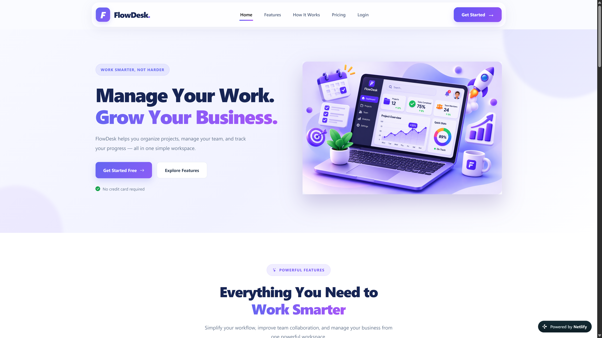
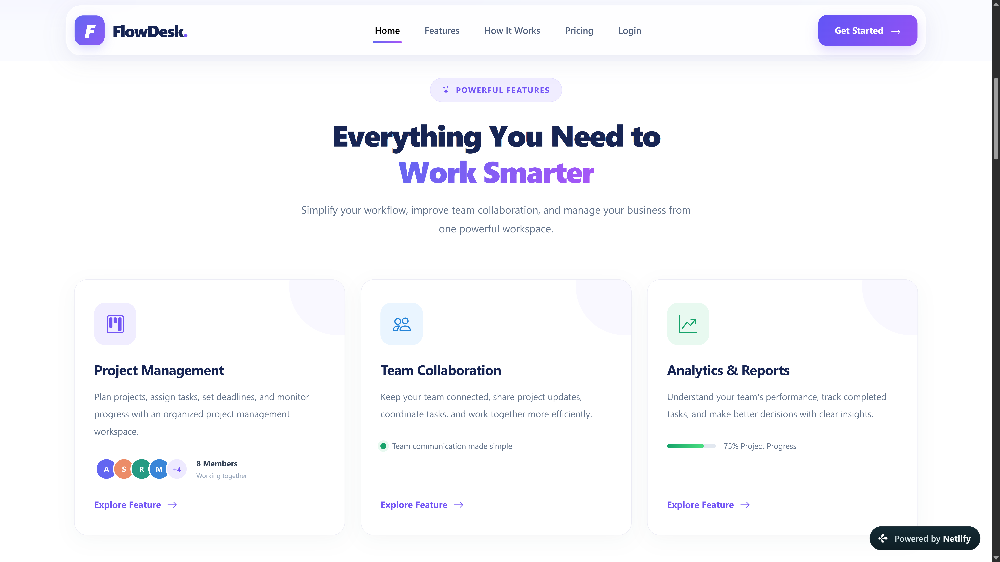
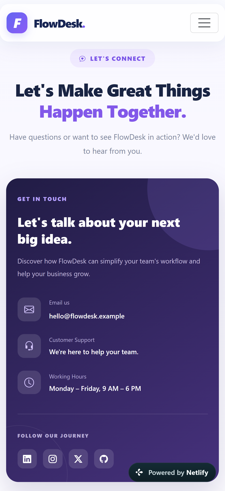

# FlowDesk – SaaS Project Management Landing Page

A modern, responsive SaaS landing page for FlowDesk, a project management platform designed to help teams organize projects, collaborate efficiently, and track their progress.

## 🌐 Live Demo

[Visit FlowDesk Website](https://voluble-faun-8944d0.netlify.app/)

## 💻 GitHub Repository

[View Source Code on GitHub](https://github.com/Skrishna0703/Sankar-Group---Front-End-Development-Internship-Assignment)

## 📸 Screenshots

### Desktop – Homepage



### Desktop – Features Section



### Mobile – Responsive Layout





## ✨ Features

- Modern and responsive navigation bar
- Attractive hero section with dashboard visual
- Project management feature cards
- Team collaboration section
- Analytics and reports section
- How It Works section
- Pricing plans
- Contact form with input validation
- Form submission success message
- Smooth scrolling and hover animations
- Responsive layout for mobile, tablet, and desktop

## 🛠️ Technologies Used

- HTML5
- CSS3
- JavaScript
- Bootstrap 5
- Bootstrap Icons

## 🚀 Run Locally

1. Clone the repository:

   ```bash
   git clone https://github.com/Skrishna0703/Sankar-Group---Front-End-Development-Internship.git
   ```
2. Open the project folder.
3. Open `index.html` in your browser.

   Alternatively, use the Live Server extension in Visual Studio Code.

## 📁 Project Structure

```text
FlowDesk/
│
├── images/
│   ├── desktop-home.png
│   ├── desktop-features.png
│   └── mobile-home.png
│
├── index.html
├── style.css
├── script.js
└── README.md
```

## 🎨 Design Approach

I developed FlowDesk with a clean, modern SaaS design and a consistent purple-themed visual identity.

The layout includes sections for product features, workflow, pricing, and contact information.

Bootstrap 5 provides responsive layouts, while custom CSS adds animations, hover effects, and visual styling.

JavaScript handles form validation and interactive functionality.

The website is designed to provide a consistent experience across desktop, tablet, and mobile devices.

One of the main challenges was maintaining responsive layouts while keeping the design visually consistent.

## 👨‍💻 Author

Developed as part of the Sankar Group Front-End Development Internship Assignment.
